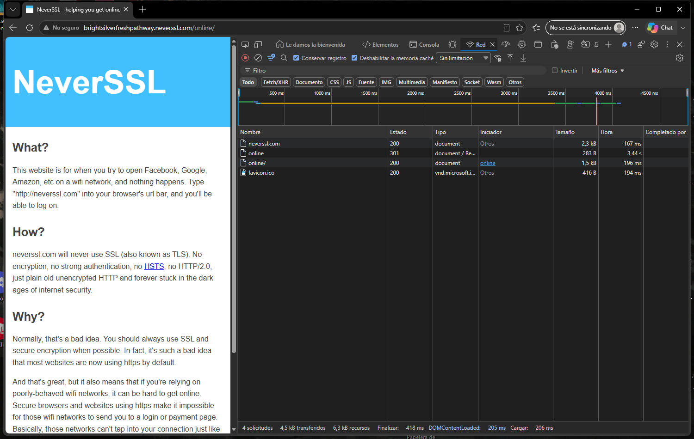
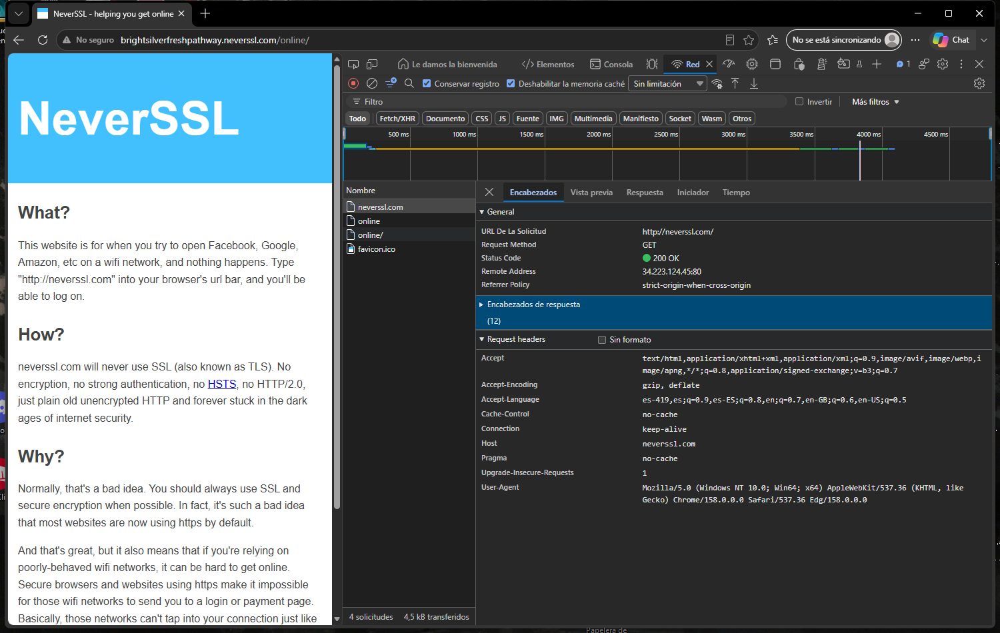
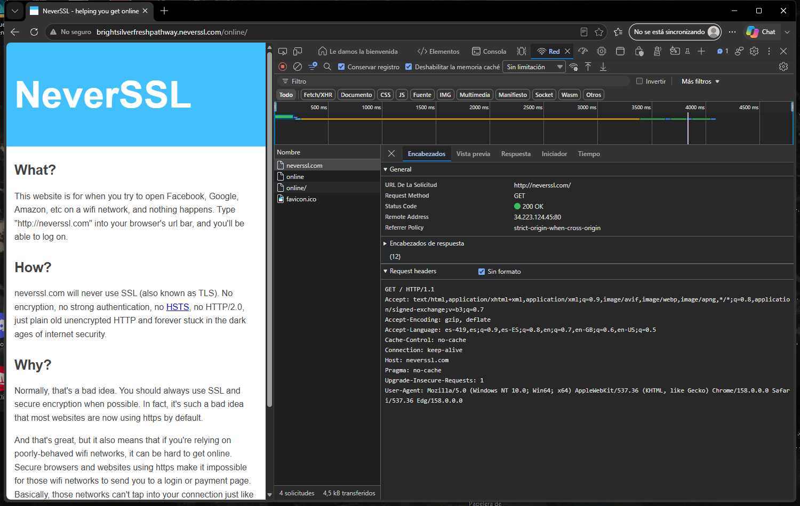
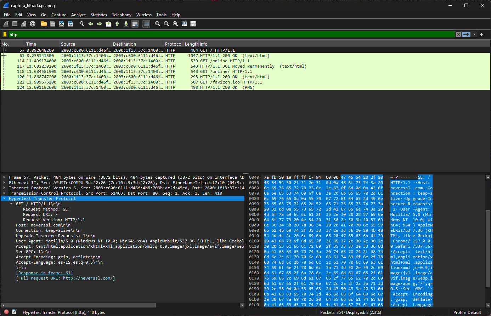

# practica-wifi-segura

Informe de Auditoría de Red Wi-Fi Insegura
Autor: Victor Miranda · Fecha: 21 de noviembre de 2026 · Rol: Auditor de seguridad junior
---
1. Introducción
Cuando una persona se conecta al Wi-Fi de una cafetería, un aeropuerto o un hotel, comparte el mismo medio de transmisión (el "aire") con desconocidos. Si el tráfico no está cifrado, cualquiera conectado a esa red puede leerlo con herramientas de libre acceso como Wireshark.
En esta auditoría analicé una conexión HTTP real con las herramientas de desarrollador del navegador para documentar qué información queda expuesta, qué riesgos implica en una red pública y cómo una VPN cambia ese escenario.
Conceptos clave
Concepto	Definición breve
HTTP	Protocolo web que envía la información en texto plano, como una postal que cualquiera puede leer. Usa el puerto 80.
HTTPS	HTTP dentro de un canal cifrado con TLS, como una caja fuerte cerrada. Usa el puerto 443.
Sniffing	Captura y lectura del tráfico que circula por una red.
Man-in-the-Middle (MitM)	Ataque en el que el atacante se ubica entre la víctima y el router, y todo el tráfico pasa por su equipo.
Evil Twin	Punto de acceso falso con un nombre parecido al legítimo (por ejemplo, `Starbucks_Gratis`) creado para capturar tráfico.
VPN	Red privada virtual que crea un túnel cifrado entre el dispositivo y un servidor de confianza.
---
2. Sitio analizado
Dato	Valor
Sitio	`http://neverssl.com` (sitio de ejemplo inseguro indicado por la consigna)
Host	`neverssl.com`
Protocolo	HTTP/1.1, sin cifrado (no usa HTTPS ni TLS)
Puerto	80
Herramienta	Microsoft Edge, herramientas de desarrollador (F12), pestaña Red
`neverssl.com` existe precisamente para no usar nunca cifrado: sirve para forzar la página de inicio de sesión de las redes Wi-Fi públicas (portal cautivo). Por eso es un caso ideal para observar tráfico HTTP sin protección.
---
3. Evidencia observada
Procedimiento
Abrí `http://neverssl.com` en Microsoft Edge.
Abrí las herramientas de desarrollador con F12 y seleccioné la pestaña Red.
Activé Conservar registro y Deshabilitar la memoria caché, para que la página se descargara de nuevo desde el servidor y no desde la caché del navegador.
Recargué la página.
Seleccioné la primera solicitud (`neverssl.com`) y revisé la pestaña Encabezados.

Figura 1. Panel Red al cargar `http://neverssl.com`: la barra de direcciones marca el sitio como "No seguro" y se registran 4 solicitudes.
En la lista se ve el recorrido completo: la primera solicitud a `neverssl.com` (200), una redirección `301` hacia un subdominio aleatorio de neverssl.com (`/online`), la página final `online/` (200) y el ícono `favicon.ico`. Todas viajan por HTTP.

Figura 2. Pestaña Encabezados de la primera solicitud: URL, método, código de estado, dirección remota en el puerto 80 y encabezados enviados.

Figura 3. Los mismos encabezados con la opción "Sin formato": la primera línea `GET / HTTP/1.1` muestra el método, la URL y el protocolo tal como viajan por la red.
Datos de la primera solicitud
Campo	Valor observado
URL solicitada	`http://neverssl.com/`
Método HTTP	`GET`
Host	`neverssl.com`
Protocolo	`HTTP/1.1`
Código de respuesta	`200 OK`
Dirección remota	`34.223.124.45:80` (puerto 80, el de HTTP sin cifrar)
Servidor	`Apache/2.4.68` (dato de la respuesta)
Encabezados enviados por el navegador (visibles en texto plano):
Encabezado	Valor observado	Qué revela
`Host`	`neverssl.com`	El sitio exacto que estoy visitando.
`User-Agent`	`Mozilla/5.0 (Windows NT 10.0; Win64; x64) ... Chrome/158.0.0.0 ... Edg/158.0.0.0`	Mi navegador (Edge 158), el motor que usa y mi sistema operativo (Windows de 64 bits).
`Accept-Language`	`es-419,es;q=0.9,es-ES;q=0.8,en;q=0.7,...`	Mis idiomas preferidos: español de Latinoamérica primero. Es una pista sobre mi región.
`Accept` / `Accept-Encoding`	`text/html,...` / `gzip, deflate`	Los formatos de contenido y compresión que acepta mi navegador.
`Upgrade-Insecure-Requests`	`1`	El navegador pide pasar a HTTPS, pero el servidor no lo ofrece.
`Cache-Control` / `Pragma`	`no-cache`	Aparecen porque desactivé la caché para la prueba.
Evidencia complementaria: la misma solicitud vista desde la red
En una práctica anterior capturé con Wireshark el tráfico de mi propia computadora mientras visitaba el mismo sitio. La Figura 4 muestra lo que vería un atacante en una red Wi-Fi: la solicitud `GET /` con el `Host: neverssl.com`, el `User-Agent` y el resto de los encabezados, todo legible sin ningún esfuerzo. DevTools muestra la solicitud desde dentro del navegador; Wireshark, desde la red, que es donde está el atacante.

Figura 4. Captura de Wireshark (filtro `http`): la solicitud a neverssl.com viaja en texto plano.
---
4. Análisis de la solicitud
4.1 ¿Qué protocolo utiliza el sitio?
Utiliza HTTP, no HTTPS. Se comprueba en tres lugares: la URL empieza con `http://`, el navegador muestra el aviso "No seguro" junto a la dirección y la conexión se realiza por el puerto 80. No hay certificado ni negociación TLS, por lo que el contenido no está cifrado.
4.2 ¿Qué información puede observarse durante la solicitud?
Cualquier persona que capture el tráfico puede ver, como mínimo:
El host: `neverssl.com`, es decir, qué sitio visito.
La URL completa y el método: `GET /`, es decir, qué página exacta pido.
El User-Agent: qué navegador y qué sistema operativo uso.
Los demás encabezados: idioma, formatos aceptados y, si existieran, cookies de sesión.
La respuesta completa: el código `200 OK` y el HTML de la página.
5. Riesgos encontrados
¿Qué riesgos existen al navegar por HTTP desde una red Wi-Fi pública?
Riesgo	Cómo ocurre	Qué podría interceptar o hacer el atacante
Intercepción (sniffing)	Alguien en la misma red captura los paquetes con Wireshark.	Sitios visitados, páginas exactas, formularios enviados y, en un login por HTTP, el usuario y la contraseña en texto plano.

Robo de sesión	Las cookies de sesión viajan en los encabezados sin cifrar.	Copiar la cookie y entrar a la cuenta de la víctima sin conocer su contraseña.
Man-in-the-Middle	El atacante se hace pasar por el router (por ejemplo, con ARP spoofing).	Leer y modificar las páginas: inyectar publicidad, scripts maliciosos o enlaces de descarga falsos, ya que HTTP no garantiza la integridad.
Evil Twin	La víctima se conecta a un punto de acceso falso con un nombre creíble.	Todo el tráfico pasa por el equipo del atacante desde el primer momento.
Perfilado	Los encabezados revelan navegador, sistema e idioma.	Armar un perfil de la víctima para ataques dirigidos, como phishing a medida.
Ejemplo práctico: si en la cafetería inicio sesión en un foro que todavía usa HTTP, el atacante de la mesa de al lado ve en Wireshark una solicitud `POST` con `usuario=...&password=...` en texto plano. Si reutilizo esa contraseña en otros servicios, el daño se extiende a todas esas cuentas.
Que la red tenga contraseña no cambia esto: si la clave del Wi-Fi está impresa en el ticket, todos los clientes la tienen y pueden capturar el tráfico de los demás.
---
6. Cómo ayuda una VPN
¿Cómo cambiaría este escenario utilizando una VPN?
Cifrado: antes de salir de mi equipo, cada paquete se cifra con algoritmos robustos (por ejemplo, AES o ChaCha20). Aunque la solicitud original sea HTTP en texto plano, en la red Wi-Fi solo viaja contenido cifrado.
Túnel seguro y encapsulamiento: la VPN aplica encapsulamiento: mete el paquete original (con su `GET /`, el `Host` y los encabezados) dentro de otro paquete cifrado dirigido al servidor VPN. Ese túnel atraviesa toda la red pública; el paquete se desencapsula y descifra recién en el servidor VPN.
Protección del tráfico: un atacante con Wireshark en la cafetería solo vería paquetes cifrados entre mi equipo y la IP del servidor VPN. No podría leer el host, la URL, los encabezados ni las cookies, ni modificar las páginas sin que la conexión lo detecte.
Privacidad: ni el dueño del Wi-Fi ni el proveedor de internet pueden saber qué sitios visito, y el sitio de destino ve la IP del servidor VPN en lugar de la mía.
Lo que ve el atacante en el Wi-Fi	Sin VPN	Con VPN
Sitio visitado (`Host`)	Sí	No
URL y método (`GET /`)	Sí	No
Encabezados y cookies	Sí	No
Contenido de la página	Sí	No
Que estoy conectado a una VPN	No aplica	Sí, pero no a qué sitios
Límite importante: la VPN protege el tramo entre mi equipo y el servidor VPN. Entre el servidor VPN y `neverssl.com` el tráfico vuelve a viajar por HTTP sin cifrar, y el proveedor de la VPN podría verlo. Por eso la VPN complementa a HTTPS, pero no lo reemplaza. También conviene activar el Kill Switch, para que, si el túnel se cae, el equipo no siga enviando tráfico sin cifrar por la red pública.
---
7. 3 Reglas de Oro para navegar en redes Wi-Fi públicas
Regla 1 · VPN siempre encendida, con Kill Switch
Antes de abrir cualquier aplicación, conectar una VPN de confianza (con política de no registros, nunca una VPN gratuita desconocida) y verificar que el Kill Switch esté activo. Así todo el tráfico viaja por un túnel cifrado aunque la red sea hostil.
Regla 2 · Solo HTTPS, y nada sensible si no es posible
Comprobar el candado y el `https://` en la barra de direcciones y activar el modo "Solo HTTPS" del navegador. Si un sitio muestra "No seguro", no iniciar sesión, no escribir contraseñas y no entrar al banco ni al correo; mejor usar los datos móviles.
Regla 3 · Verificar la red antes de conectarse y olvidarla al terminar
Confirmar con el personal del local el nombre exacto de la red para no caer en un Evil Twin, desactivar la conexión automática a redes abiertas y, al salir, usar "Olvidar esta red". En Windows, marcar la red como Pública para que el equipo no sea visible ni comparta archivos.
---
8. Conclusiones
La auditoría demuestra que una solicitud HTTP en una red pública expone el sitio visitado, la URL, el navegador, el sistema operativo y el contenido completo de la página, sin que el atacante tenga que vulnerar nada: le basta con escuchar. HTTPS protege el contenido de cada sitio, y la VPN agrega una capa de cifrado y encapsulamiento sobre toda la conexión. Combinadas con hábitos de verificación, convierten a una red Wi-Fi pública en un riesgo controlado.
---
Referencias
NeverSSL: http://neverssl.com
Microsoft Edge DevTools, panel Red: learn.microsoft.com/microsoft-edge/devtools-guide-chromium/network
MDN Web Docs, encabezados HTTP: developer.mozilla.org/es/docs/Web/HTTP/Headers
